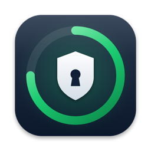

# 2FA-vlv

<p align="center">
  
</p>

<p align="center">
  <strong>Two-factor codes for your Mac. Open source, offline, and simpler than the original.</strong><br>
  Open it. Click a code. Paste it. Done.
</p>

<p align="center">
  <a href="https://github.com/VlV-515/2fa-vlv">View source</a>
  ·
  <a href="https://github.com/VlV-515/2fa-vlv/releases">Releases</a>
  ·
  <a href="https://sourceforge.net/projects/2fa-vlv/">SourceForge</a>
  ·
  <a href="#get-2fa-vlv">Get it</a>
  ·
  <a href="#using-2fa-vlv">How it works</a>
  ·
  <a href="#language">Languages</a>
  ·
  <a href="docs/README.es.md">Leer en español</a>
</p>

<p align="center">
  
  
  
  
  <a href="LICENSE"></a>
</p>

2FA-vlv is a native Mac authenticator for people who sign in to a lot of things. It shows live 6-digit codes with a countdown ring, copies a code with one click, and keeps your secrets on your Mac. Nothing leaves your machine.

No account. No subscription. No telemetry. No server. Just your codes.

## Why 2FA-vlv?

- **Dead simple.** One window, one search box, one click to copy. Nothing else in your way.
- **Open source.** Read every line, build it yourself, change it. MIT licensed.
- **Yours alone.** Secrets live in the macOS Keychain (or a `0600` file if you prefer). No cloud, no sign-in.
- **Bring your codes.** Import your LastPass Authenticator backup in one step. Add others from a `otpauth://` link or a QR code.
- **Stays organized.** Favorites, folders, drag-and-drop order, and a colored badge per service.
- **Fast from anywhere.** Menu bar popover and an optional global shortcut (`⌃⌥⌘2`).
- **Your language.** English by default, Spanish one click away.

## At a glance

| 2FA-vlv does | 2FA-vlv deliberately does not do |
| --- | --- |
| Generates TOTP, HOTP and Steam Guard codes (SHA1, SHA256, SHA512, 4-10 digits) | Sync through iCloud or any server |
| Imports LastPass Authenticator JSON backups | Replace a password manager |
| Adds accounts by hand, `otpauth://` link, QR image or screen capture | Run on iPhone, Windows, Linux or the web |
| Stores secrets in the Keychain, locks with Touch ID or password | Send analytics or crash reports |
| Clears copied codes from the clipboard automatically | Encrypted export (not yet) |

## Get 2FA-vlv

Requirements: macOS 13 or later and the Swift toolchain (Xcode or Command Line Tools).

```bash
git clone https://github.com/VlV-515/2fa-vlv.git
cd 2fa-vlv
swift build && ./scripts/package-app.sh && open dist/2FA-vlv.app
```

Prebuilt zips will appear on the [Releases](https://github.com/VlV-515/2fa-vlv/releases) page and on [SourceForge](https://sourceforge.net/projects/2fa-vlv/). They are ad-hoc signed, so on first launch right-click the app and choose **Open**.

## Using 2FA-vlv

1. **Import or add accounts.** Use **+ → Import LastPass Backup...** or **+ → Add Account...**.
2. **Click a code** to copy it. It is cleared from the clipboard after 30 seconds (configurable).
3. **Organize.** Right-click an account to favorite it, move it to a folder, edit it or delete it. Drag to reorder.
4. **Harden it (optional).** In **Settings → Security** turn on Touch ID / password lock and auto-lock.

### Import from LastPass Authenticator

Export your accounts from LastPass Authenticator as a JSON backup, then **+ → Import LastPass Backup...**. Folders and favorites come along. Accounts you already have are skipped. Your backup file stays where it is; 2FA-vlv only reads it.

### Optional features

Every extra is a switch in Settings, so you keep the app as minimal as you like:

| Feature | Where |
| --- | --- |
| Hide codes until clicked | Settings → General |
| Menu bar icon and global shortcut | Settings → General |
| Launch at login | Settings → General |
| Keychain storage | Settings → Security |
| Touch ID / password lock, auto-lock | Settings → Security |
| Clear clipboard after copy | Settings → Security |

## Language

2FA-vlv starts in English. Switch to Spanish (🇲🇽) or back to English (🇺🇸) in **Settings → General**. The change is instant.

## Security notes

- Secrets are stored in one Keychain item. If you turn Keychain off they live in `~/Library/Application Support/2FA-vlv/vault.json` with `0600` permissions.
- Copied codes are flagged as concealed so clipboard managers (like paste-vlv) skip them.
- Ad-hoc signed builds can make macOS ask for Keychain access again after an update. Choose **Always Allow**.
- A lost or wiped Mac means lost codes. Keep recovery codes for important accounts. Backups are on the roadmap.

## Project

- Source: [github.com/VlV-515/2fa-vlv](https://github.com/VlV-515/2fa-vlv)
- Downloads: [sourceforge.net/projects/2fa-vlv](https://sourceforge.net/projects/2fa-vlv/)
- Author: [VlV-515](https://github.com/VlV-515)
- Docs for people: [docs/](docs/README.md)
- License: [MIT](LICENSE)

Part of the VlV family of small, native Mac tools, like [paste-vlv](https://github.com/VlV-515/paste-vlv) and [caffeine-vlv](https://github.com/VlV-515/caffeine-vlv).
